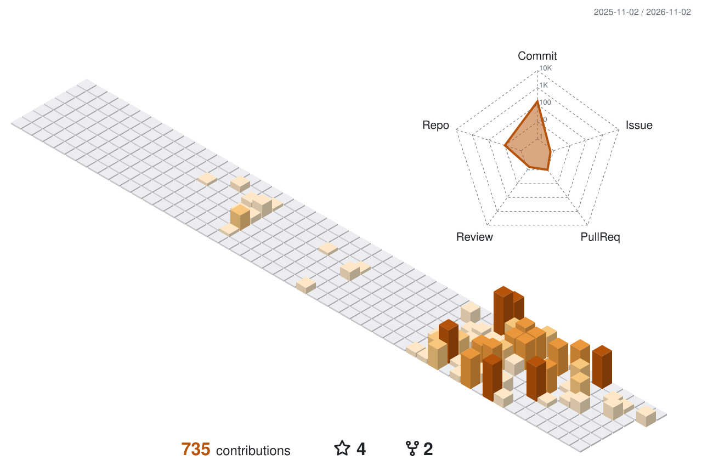

<picture>
  <source media="(prefers-color-scheme: dark)" srcset="assets/header-dark.svg">
  
</picture>

Backend mühendisliği ile yapay zekânın kesiştiği yerde çalışıyorum. **.NET ve FastAPI** ile ölçeklenebilir, çok kiracılı servisler kuruyor; bu servislerin üzerinde **makine öğrenmesi, derin öğrenme ve veri bilimi** modelleri eğitiyor, **LLM, RAG ve AI ajanlarıyla** onları konuşan, araç kullanan ve karar veren sistemlere dönüştürüyorum. Uydu görüntüsünden yol hasarı çıkaran segmentasyon modellerinden kasada milisaniyeler içinde çalışan öneri motorlarına, gerçek zamanlı nesne tespitinden çok ajanlı asistanlara kadar uçtan uca ürünler geliştiriyorum.

### ÖNE ÇIKAN PROJE

**PAYDA**, zincir marketler ve toptancılar için geliştirdiğim yapay zekâ ajanlı, çok kiracılı bir SaaS platformu ve KTO Karatay Üniversitesi Bilgisayar Mühendisliği bitirme projem. Gerçek bir toptan gıda zincirinin satış verisi üzerinde; kasada anında cevap veren bir öneri ve kural çekirdeğini, müşteriyle, çalışanla ve toptan alıcıyla konuşan bir ajan takımıyla tek platformda birleştiriyor.

- **Backend ve platform:** ASP.NET Core ve EF Core ile çok kiracılı mimari, PostgreSQL Row Level Security ile veritabanı seviyesinde kiracı izolasyonu, JWT ve rol tabanlı yetki, Redis, Hangfire ile gece işleri, Nginx yük dengeleme ve YARP API gateway.
- **Veri mühendisliği:** DuckDB, PySpark ve Pandas ile ETL/ELT hatları, HMAC ile anonimleştirme, feature store, tek kaynaktan tanımlanan metrik katmanı ve veri kalitesi skoru.
- **Makine öğrenmesi:** FBT, Item2Vec, ALS ve LightGBM Learning-to-Rank'i birleştiren hibrit öneri motoru; K-Means ve RFM ile müşteri segmentasyonu; LightGBM ile aralık tahmini veren talep tahmini ve ikmal; kişisel alım ritminden kayıp riski.
- **Derin öğrenme:** PyTorch ile two-tower öneri modeli, Türkçe Transformer ile ürün yorumlarında konu bazlı duygu analizi, ürün kategorilerini dolduran sınıflandırıcı.
- **LLM ve RAG:** Ollama ile yerelde çalışan LLM'ler, pgvector üzerinde kaynak gösteren RAG, JSON şemalı yapılandırılmış çıktı, anahtar kelime ve anlamsal aramayı birleştiren hibrit arama, sürümlenen ve test edilen prompt'lar.
- **AI ajanları:** Yönlendiricinin dağıttığı müşteri, çalışan ve toptan ajanlarından oluşan uzman takım; araç çağırma, ReAct döngüsü, ortak hafıza ve insan onayı; LangGraph; sesli ve fotoğraflı sipariş için Whisper ve OCR.
- **MLOps:** Model registry, kalite kapıları ve geri alma, ajan ve RAG değerlendirme setleri, A/B deney servisi, Docker ve GitHub Actions ile CI.

### PROJELER

### ŞU AN

PAYDA'nın temel platformunu ve veri katmanını kuruyorum; sırada öneri motoru, yerel LLM ölçümleri ve ajan takımı var. Bir yandan da .NET tarafında sistem tasarımı (yük dengeleme, cache, API gateway, kimlik) ve LLM tarafında RAG kalitesi ile ajan güvenilirliği üzerine derinleşiyorum.

### BİLDİKLERİM

<b>dil</b> 
    
<b>backend</b> 
          
<b>veri</b> 
           
<b>ml</b> 
        
<b>dl · cv</b> 
         
<b>llm · rag · agents</b> 
           
<b>mlops · cloud</b> 
        

### AKTİVİTE

<picture>
  <source media="(prefers-color-scheme: dark)" srcset="profile-3d-contrib/femrei-dark.svg">
  
</picture>

<picture>
  <source media="(prefers-color-scheme: dark)" srcset="https://raw.githubusercontent.com/Femrei/Femrei/output/snake-dark.svg">
  
</picture>

### İLETİŞİM

 
